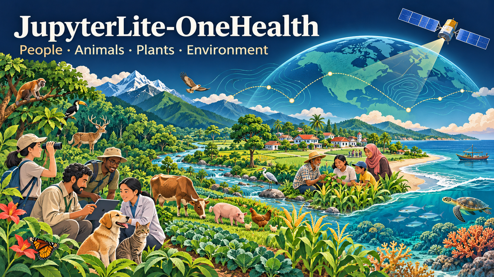

# JupyterLite-OneHealth

[**Learning site**](https://jltobias.github.io/JupyterLite-OneHealth/) · [**Jupyter Book**](https://jltobias.github.io/JupyterLite-OneHealth/book/) · [**JupyterLite Lab**](https://jltobias.github.io/JupyterLite-OneHealth/lite/lab/index.html) · [**Study-area profile**](https://jltobias.github.io/JupyterLite-OneHealth/explorer/profile/)

[2D Maps](https://jltobias.github.io/JupyterLite-OneHealth/explorer/2d/) · [3D Maps](https://jltobias.github.io/JupyterLite-OneHealth/explorer/3d/) · [3D Scenes](https://jltobias.github.io/JupyterLite-OneHealth/explorer/scene/) · [Data visualizations](https://jltobias.github.io/JupyterLite-OneHealth/explorer/charts/) · [One Health Lab](https://jltobias.github.io/JupyterLite-OneHealth/explorer/lab/) · [Resources](https://jltobias.github.io/JupyterLite-OneHealth/book/resources/)

[CDC and EPA case-study guide](https://jltobias.github.io/JupyterLite-OneHealth/book/case-studies/) · <a href="https://www.cdc.gov/one-health/php/stories/index.html" target="_blank" rel="noopener noreferrer">CDC case stories</a> · [EPA case studies and examples](https://www.epa.gov/one-health/one-health-case-studies-and-examples)



**Explore real Landsat observations and Census population, ask One Health questions, and run original Python lessons.**

> **Project status:** the dedicated site, real-data snapshot, eleven notebooks, Book, Lab and profiler are implemented. [Build and deployment status](https://github.com/jltobias/JupyterLite-OneHealth/actions/workflows/deploy.yml) tracks the published build.

The starter uses **actual public-domain USGS Landsat and U.S. Census data for Fresno, California**. No observations, geography, illness counts, terrain or intervention outcomes are simulated. The original splash remains a clearly labeled conceptual illustration. Original code and lessons connect CDC, EPA, WHO, NOAA, USGS and NASA perspectives with Global Health and Spatial Epidemiology.

## Why One Health?

Human wellbeing depends on relationships among communities, domestic and wild animals, plants, and ecosystems. The [WHO One Health overview](https://www.who.int/health-topics/one-health#tab=tab_1) frames these relationships as an integrated approach spanning sectors and scales. [CDC's introduction](https://www.cdc.gov/one-health/about/index.html) connects that approach to zoonoses, antimicrobial resistance, food and water, and environmental change.

This project explores those connections through reproducible, place-based learning. A watershed, a coastal community, a farm, or a border region can become a shared case study viewed through public health, ecology, climate science, Earth observations, and community priorities.

The intended audience includes students, educators, public-health practitioners, epidemiologists, veterinarians, environmental scientists, and GIS learners. Introductory lessons should explain the Python and spatial concepts they use.

## Agency perspectives

The sources introduce complementary perspectives. **The lessons are original project activities**, informed by linked readings and actual federal environmental/population data. They are not agency-produced lessons or validated assessments.

| Perspective and source | Connection to One Health | Original learning question |
| --- | --- | --- |
| **CDC** — [One Health](https://www.cdc.gov/one-health/index.html) | Human–animal–environment connections; zoonotic and vector-borne diseases, antimicrobial resistance, and food safety. | Identify surveillance evidence missing from satellite and population data; examine reporting gaps, time alignment and denominators. |
| **EPA** — [One Health case studies and examples](https://www.epa.gov/one-health/one-health-case-studies-and-examples) | Environmental monitoring and collaboration among health, conservation, agriculture and environmental agencies. | Design a watershed sampling plan and identify the chemical, biological and institutional evidence missing from an EO/population profile. |
| **WHO** — [One Health overview](https://www.who.int/health-topics/one-health#tab=tab_1) | Collaboration across sectors, prevention, equity, and action from community to global scales. | Map stakeholders and document the evidence needed to evaluate interventions, co-benefits and trade-offs. |
| **NOAA** — [About NOAA One Health](https://cpo.noaa.gov/about-noaa-one-health/) and [NOAA's algal-bloom explainer](https://oceanservice.noaa.gov/facts/habharm.html) | Marine and freshwater conditions connect ecosystem health, animals, human exposure, and coastal livelihoods. | Explore spectral water proxies; distinguish surface appearance from evidence of toxicity or illness. |
| **USGS** — [One Health conceptual diagram](https://www.usgs.gov/media/images/one-health-conceptual-diagram) | Environmental contaminants, source-to-receptor pathways, wildlife exposure, and ecosystem conditions. | Trace a conceptual watershed pathway and compare potential exposure locations, sampling coverage, and uncertainty. |
| **NASA** — [Landsat 9 mission](https://science.nasa.gov/mission/landsat-9/) | Earth observations, sensor characteristics, acquisition timing and field-validation needs. | Compare actual Landsat spectral measurements with the observations needed to answer a One Health question; inspect spatial support, acquisition dates and field-validation gaps. |

The supplied NASA DEVELOP presentation is retained only as an **unused, excluded external reference** in the bibliography. Its cases, slides, prose, photographs and figures are not used as lesson material. The implemented NASA perspective uses general sensor questions and the linked Landsat mission resource.

**Source review:** checked on **7 November 2026**. CDC, EPA, WHO, USGS, and the NASA PDF were accessible. The supplied NOAA CPO URL returned **403 Forbidden** during review; it is retained as a requested resource. The NOAA descriptions above are supported by the separately linked National Ocean Service explainer. These organizations are credited as sources; no affiliation or endorsement is implied.

**CDC attribution and disclaimer:** Source: Centers for Disease Control and Prevention (CDC). The linked CDC resources were developed by CDC and are available at no charge on its website. References, links, and this project's educational summaries do not imply endorsement of this project, its contributors, products, or services by CDC, ATSDR, the Department of Health and Human Services (HHS), or the United States Government. The original agency resources remain on CDC's website. See [CDC's Use of Agency Materials policy](https://www.cdc.gov/other/agencymaterials.html).

## CDC stories and EPA case studies

The <a href="https://www.cdc.gov/one-health/php/stories/index.html" target="_blank" rel="noopener noreferrer">CDC One Health in Action Stories</a> collection and [EPA One Health Case Studies and Examples](https://www.epa.gov/one-health/one-health-case-studies-and-examples) provide real investigations, partnerships and research examples. The [Book case-study guide](book/case-studies.md) connects six selections to existing lessons through original discussion questions and evidence-planning exercises.

| Agency reading | Brief original summary | Connection to this repository |
| --- | --- | --- |
| CDC: <a href="https://www.cdc.gov/one-health/php/stories/investigating-salmonella-and-wild-songbirds-a-one-health-approach.html" target="_blank" rel="noopener noreferrer">Investigating Salmonella and Wild Songbirds</a> | Human and wildlife investigators combined interviews and laboratory evidence during the 2020–2021 investigation. | Lessons 01 and 07: separate habitat observations from contact, pathogen and transmission evidence. |
| CDC: <a href="https://www.cdc.gov/one-health/php/stories/poisoned-sea-otters.html" target="_blank" rel="noopener noreferrer">Poisoned Sea Otters in California</a> | A 2007 Monterey Bay investigation traced a freshwater toxin pathway from Pinto Lake toward the coast. | Lessons 04 and 10: plan a land-to-sea investigation; a spectral water index cannot measure microcystin. |
| CDC: <a href="https://www.cdc.gov/one-health/php/stories/lead-poisoning.html" target="_blank" rel="noopener noreferrer">Lead Poisoning Investigation in Northern Nigeria</a> | The 2010 Zamfara investigation connected ore processing, contaminated surroundings and missed animal warnings. | Lessons 08 and 10: discuss livelihoods, community knowledge and missing exposure measurements. This is a Global Health reading, outside the U.S. profiler's data coverage. |
| CDC: <a href="https://www.cdc.gov/one-health/php/stories/understanding-antibiotic-resistance-in-water.html" target="_blank" rel="noopener noreferrer">Understanding Antibiotic Resistance in Water</a> | The story brings together human, animal and environmental perspectives on resistance in water systems. | Lessons 01 and 04: specify the microbial sampling and laboratory measurements needed beyond EO observations. |
| EPA: [Showing the Way for One Health Collaboration](https://www.epa.gov/research-states/showing-way-one-health-collaboration) | Missouri's example describes coordination across agriculture, conservation, environmental and health agencies, with training and communication. | Lessons 01, 08 and 10: create a partner-and-evidence plan for a bounded U.S. study area. |
| EPA: [Harmful algal blooms and watershed examples](https://www.epa.gov/one-health/one-health-case-studies-and-examples) | EPA describes environmental research and collaboration linking water conditions with human and animal health. | Lessons 02, 04 and 07: distinguish a study box, watershed, sampling site and population denominator. |

These are historical investigations or agency research examples, not additional datasets in the profiler. The Fresno observations from 2024 and Census counts from 2020 cannot reconstruct these events. The guide uses the real bundled data to practice question design and evidence assessment; it does not assign illness, toxin, lead or resistance measurements to satellite pixels. Additional EPA topics on the linked collection include EnviroAtlas, wastewater surveillance, wildfire smoke and antimicrobial-resistance monitoring.

**Attribution and rights:** CDC stories are credited to CDC and its National Center for Emerging and Zoonotic Infectious Diseases, with the investigation partners identified in each original story. EPA case-study and example descriptions are credited to the U.S. Environmental Protection Agency; Missouri's participating agencies and other partners retain their original credit. The summaries and exercises here are original project writing. Agency stories, photographs, quotations, figures, videos, PDFs and third-party map assets remain on their source sites. Public-domain status is established separately for the actual USGS/Census inputs; linking an agency collection does not establish rights to every item it links. See [CDC's materials policy](https://www.cdc.gov/other/agencymaterials.html), [EPA's disclaimers and item-specific copyright guidance](https://www.epa.gov/web-policies-and-procedures/epa-disclaimers), and the dated entries in [Citations and attributions](#citations-and-attributions). References do not imply endorsement by EPA or any participating agency; the CDC disclaimer above also applies to all story links.

## Global Health and Spatial Epidemiology

**Global Health** connects every agency module to equity, livelihoods, food and water security, mobility, access to care, and resilient health services. Learners should ask whose health is represented, who bears a burden, which evidence is missing, and how decisions can be developed with affected communities.

**Spatial Epidemiology** provides the methods for investigating where and when patterns occur: counts versus rates, population denominators, spatial joins, proximity, exposure, clustering, service access, and change over time. Exercises should examine how map scale, reporting effort, confounding, and uncertainty affect interpretation. Geographic overlap alone does not establish transmission or causation.

Together, these perspectives connect an environmental observation to a health question while making the assumptions and limits of that connection visible.

## The implemented learning experience

The portal, responsive explorer, Jupyter Book 2 and JupyterLite Python Lab share one real snapshot. The explorer supports bounding-box entry and map selection, synchronized measurements and charts, orbitable data columns, a georeferenced reflectance scene, accessible tables and CSV/JSON exports. Heights encode measured values or whole-tract population, never invented elevation.

Default bounds are `[-119.90, 36.65, -119.65, 36.90]`. Satellite scene `LC09_L2SP_042035_20240830_02_T1` was acquired **30 August 2024**; Census POP100 refers to **1 April 2020**. The starter contains 6,890 systematic samples of actual native product pixels and 166 real tract polygons. The 764,468 people in those whole tracts are **not the population inside the box**. A separate, labeled bbox estimate uses polygon-area fractions and assumes uniform population within each tract.

Surface temperature is not air temperature or personal exposure. NDVI and the declared green-NIR NDWI are environmental proxies, not illness indicators. No health-risk scores, probabilities or forecasts are computed. See [methods](book/methods.md) and the [machine-readable manifest](content/data/manifest.json).

### Profile another U.S. study area

Enter a U.S. bounding box and select **Create profile from live sources**. The browser retrieves real Landsat bands and complete 2020 Census tract pages, transforms projected coordinates, masks quality flags and records source identities. Service failures, unavailable temperature, unsupported projections, excessive memory requirements and absent Census coverage remain explicit errors. The previous valid profile stays labeled until a complete new profile is ready. Public-domain U.S. coverage is the supported starting scope.

For reproducible local acquisition, install `requirements-acquire.txt` and run:

```bash
python scripts/acquire_data.py --bbox -119.90 36.65 -119.65 36.90 --output my-profile
```

Import `my-profile/profile-package.json` in the explorer. Bounds are limited to 0.5 degrees on each axis, with a one-million-native-pixel cap; smaller areas may be needed. Live scene search defaults to June 2024 through September 2025. The CLI accepts `--datetime START/END`. Signed provider URLs remain transient and are never committed or exported.

### Eleven original lessons

| Notebook | Learning focus |
|---|---|
| [00 - Provenance and profile](content/00_provenance_profile.ipynb) | Sources, bounds, dates, support and reproducible summaries. |
| [01 - Agency questions](content/01_agency_questions.ipynb) | An agency evidence inventory, extended by the CDC/EPA case-study guide. |
| [02 - Population](content/02_population.ipynb) | Whole-tract counts, reference date and bbox limitations. |
| [03 - QA and scaling](content/03_qa_scaling.ipynb) | Actual DNs, quality bits, masking and calibration. |
| [04 - Vegetation and water](content/04_vegetation_water.ipynb) | Scaled spectral ratios and proxy interpretation. |
| [05 - Surface heat](content/05_surface_heat.ipynb) | Actual temperature distribution and exposure limits. |
| [06 - Spatial scale](content/06_spatial_scale.ipynb) | Sampling, resolution and spatial dependence. |
| [07 - EO/population joins](content/07_eo_population_joins.ipynb) | Real point-in-polygon joins and ecological inference. |
| [08 - Equity and gaps](content/08_equity_evidence_gaps.ipynb) | Global Health questions without invented vulnerability scores. |
| [09 - Visualization and 3D](content/09_visualization_3d.ipynb) | Measured heights, perspective and alternatives. |
| [10 - Capstone](content/10_capstone.ipynb) | A bounded evidence brief, figure, limits and next observations. |

Each notebook contains original explanations, calculations, figures, cited context, interpretation prompts and an exercise. Browser Python loads runtime/packages on first use; internet access can be required. Download edited notebooks and generated files to preserve them outside browser storage. Desktop and browser execution are separate verification targets.

## Build on related repositories

The following projects from [jltobias's repository collection](https://github.com/jltobias?tab=repositories) offer concrete starting points. **Repository credit: jltobias and each project's contributors**, including upstream authors credited in those projects. Their READMEs were examined for this introduction, with selected source notebooks also inspected. The citation column links to the exact README revisions checked on **7 November 2026**. **These are planning references only; no companion code, datasets, notebook content or assets were imported.**

| Repository | Planning references, not imported | Cited README revision |
| --- | --- | --- |
| [JupyterLite-Coral-Reef-One-Health](https://github.com/jltobias/JupyterLite-Coral-Reef-One-Health) | Reef–community connections, fictional site indicators, and transparent sensitivity to indicator weights. | [6b76d79a9b4b](https://github.com/jltobias/JupyterLite-Coral-Reef-One-Health/blob/6b76d79a9b4b683a52bbf0ba019f204e7635aaf9/README.md) |
| [JupyterLite-Climate-and-Health](https://github.com/jltobias/JupyterLite-Climate-and-Health) | Modern companion labs on heat, coral thermal stress, food/water balances, adaptation, and health-service continuity. Historical notebooks need separate compatibility checks. | [248f9860d189](https://github.com/jltobias/JupyterLite-Climate-and-Health/blob/248f9860d189502013b36b3c4271777edafc4f7f/README.md) |
| [JupyterLite-Rewiring-Global-Health](https://github.com/jltobias/JupyterLite-Rewiring-Global-Health) | Stakeholder connections, linked maps and time series, spatial model evaluation, scenario uncertainty, and geoprivacy. | [84bf945de91a](https://github.com/jltobias/JupyterLite-Rewiring-Global-Health/blob/84bf945de91ad5ae3c8b2f67e9bd3e4781cf88b9/README.md) |
| [JupyterLite-Global-Health-GIS](https://github.com/jltobias/JupyterLite-Global-Health-GIS) | Country-table-to-GeoJSON workflows and browser GIS handoffs. Its bundled GBD-style burden values are synthetic, not IHME estimates. | [fef5e9101483](https://github.com/jltobias/JupyterLite-Global-Health-GIS/blob/fef5e91014837acfd09fce5731319d84439a0194/README.md) |
| [JupyterLite-Maps-and-Spatial-Analyses](https://github.com/jltobias/JupyterLite-Maps-and-Spatial-Analyses) | Small map-based exercises using synthetic observations, buffers, grids, routes, and comparison maps. | [6949a8bf2f56](https://github.com/jltobias/JupyterLite-Maps-and-Spatial-Analyses/blob/6949a8bf2f56c2e0b73a4da537beaf686cd00452/README.md) |
| [JupyterLite-Population-Data-Comparison](https://github.com/jltobias/JupyterLite-Population-Data-Comparison) | Population-product comparisons, denominator choice, native grid differences, coverage, and provenance. | [9eb09ecbde0d](https://github.com/jltobias/JupyterLite-Population-Data-Comparison/blob/9eb09ecbde0d0a0126894d41563ce047d28e9665/README.md) |
| [JupyterLite-STAC-Browser](https://github.com/jltobias/JupyterLite-STAC-Browser) | Reproducible catalog searches, dataset footprints, asset metadata, attribution, and browser-access constraints. | [945d8b31c59e](https://github.com/jltobias/JupyterLite-STAC-Browser/blob/945d8b31c59e2cf93f9e51e855eb062fb1b4321c/README.md) |
| [JupyterLite-EO-Satellite-Guide](https://github.com/jltobias/JupyterLite-EO-Satellite-Guide) | Matching an environmental question to candidate missions, sensors, observations, and spatial/temporal characteristics. | [684833c9013b](https://github.com/jltobias/JupyterLite-EO-Satellite-Guide/blob/684833c9013bfa003bddeb7ff20edb2d4fad3347/README.md) |
| [JupyterLite-Sea-Level-Rise](https://github.com/jltobias/JupyterLite-Sea-Level-Rise) | Coastal hazard, exposure, facility access, and service-continuity scenarios with explicit assumptions. | [66065673b47f](https://github.com/jltobias/JupyterLite-Sea-Level-Rise/blob/66065673b47f9bc5c0f6e5009ac1c924a9f5200c/README.md) |
| [JupyterLite-DRC-Population-Mobility-Border-Mapping](https://github.com/jltobias/JupyterLite-DRC-Population-Mobility-Border-Mapping) | Mobility flowmaps, health-access layers, data inventories, and place-and-time storytelling. | [a73ae3ce2f07](https://github.com/jltobias/JupyterLite-DRC-Population-Mobility-Border-Mapping/blob/a73ae3ce2f071d96fe1b0a1083b468f156545aa2/README.md) |
| [Cross-Border-Ebola-Risk-Mapping-Prototype](https://github.com/jltobias/Cross-Border-Ebola-Risk-Mapping-Prototype) | Its `notebooks_lite/` synthetic examples distinguish suitability, exposure, importation pressure, and facility vulnerability; vary weights to explore uncertainty. | [24037cb8f6f9](https://github.com/jltobias/Cross-Border-Ebola-Risk-Mapping-Prototype/blob/24037cb8f6f90103917a86a733b559304620727a/README.md) |
| [1854-Cholera-Outbreak-London](https://github.com/jltobias/1854-Cholera-Outbreak-London) | A historical spatial-epidemiology case study connecting place, water, evidence, and investigation; its README also credits PHI-Case-Studies through the Binder source. | [58e47632721a](https://github.com/jltobias/1854-Cholera-Outbreak-London/blob/58e47632721a92595641930100853b647091c2c5/README.md) |
| [JupyterLite-Data-Visualization](https://github.com/jltobias/JupyterLite-Data-Visualization) | Chart selection, linked visual exploration, and repository-based teaching examples with dataset provenance. | [d6274fddef6b](https://github.com/jltobias/JupyterLite-Data-Visualization/blob/d6274fddef6b3d7d560dc71c08d1ed2b417392fc/README.md) |

Three source notebooks inspected during planning:

- **jltobias and project contributors.** [Explore One Health indicators with fictional reef sites](https://github.com/jltobias/JupyterLite-Coral-Reef-One-Health/blob/6b76d79a9b4b683a52bbf0ba019f204e7635aaf9/content/02-one-health.ipynb), `content/02-one-health.ipynb`, revision `6b76d79a9b4b`: make indicator definitions and weighting assumptions inspectable.
- **James L. Tobias and contributors.** [Food and water insecurity: a transparent mass balance](https://github.com/jltobias/JupyterLite-Climate-and-Health/blob/248f9860d189502013b36b3c4271777edafc4f7f/content/notebooks/09_food_water.ipynb), `content/notebooks/09_food_water.ipynb`, revision `248f9860d189`: connect units, supply shocks, household assumptions, and service needs. The source identifies original educational text as CC BY 4.0, original calculation code as MIT, and original synthetic fixtures as CC0; those notices apply to their respective source components.
- **jltobias and project contributors.** [JupyterLite weight sensitivity demo](https://github.com/jltobias/Cross-Border-Ebola-Risk-Mapping-Prototype/blob/24037cb8f6f90103917a86a733b559304620727a/notebooks_lite/01_jupyterlite_weight_sensitivity.ipynb), `notebooks_lite/01_jupyterlite_weight_sensitivity.ipynb`, revision `24037cb8f6f9`: compare results across sampled weights without presenting a teaching score as a validated risk estimate.

Before adapting an example, record its source revision, check code and data licenses separately, preserve required credits, explain changes, and verify the reduced lesson in JupyterLite. A public repository or an agency link does not by itself grant redistribution rights for every linked dataset or figure.

## Build and verify

Use Python 3.12 and Node 24. All Python build dependencies, including transitive dependencies, are pinned in `requirements.txt` (input in `requirements.in`). Acquisition dependencies are optional and separate.

```bash
python -m venv .venv
# Activate .venv for your operating system.
python -m pip install -r requirements.txt
python scripts/build.py --base-url /JupyterLite-OneHealth
node scripts/check_explorer.cjs
python scripts/check_acquisition.py
```

The build executes all eleven notebooks in fresh kernels, verifies snapshot hashes and scientific invariants, builds Book and Lite, and assembles `_site` with portal/explorer, data, notebooks and complete collected software notices. Use `--base-url ''` for a domain-root build. For accurate local testing, run `python scripts/serve.py` and open `http://127.0.0.1:8000/JupyterLite-OneHealth/`. The server mounts the artifact at its configured project prefix. `--skip-execution` is an iteration option only after notebooks have been successfully executed.

```bash
python scripts/check_data.py
python scripts/check_notebooks.py --execute
python scripts/check_site.py --base-url /JupyterLite-OneHealth
python scripts/check_browser.py --url http://127.0.0.1:8000/JupyterLite-OneHealth/
python scripts/check_lite.py --url http://127.0.0.1:8000/JupyterLite-OneHealth/ --all
```

Browser checks use the separate pinned tools in `requirements-verify.txt`: install them with `python -m pip install -r requirements-verify.txt`, then run `python -m playwright install chromium` (add `--with-deps` on Linux). The scripts use installed Chrome on Windows or Playwright Chromium on Linux. GitHub Actions executes all eleven desktop and fresh browser Python notebooks, checks explorer interactions and exported values, and publishes one Pages artifact. Repository Pages uses **GitHub Actions**; the workflow status records each publication.

```text
book/                 Original narrative, methods, resources and credits
content/*.ipynb       Eleven shared original notebooks
content/data/         Real snapshot, raw native crops, provenance and hashes
web/                  Portal, explorer, live acquisition and pinned vendor bundles
scripts/              Acquisition, notebook authoring, build and validation
notices/vendor/       Complete browser-library dependency notices
.github/workflows/    Validated Pages artifact deployment
```

## Contributing and attribution

Propose a lesson, an agency resource, a small reusable dataset, or a teaching improvement through [issues](https://github.com/jltobias/JupyterLite-OneHealth/issues) or [pull requests](https://github.com/jltobias/JupyterLite-OneHealth/pulls). Include the learning question, source links, expected output, data terms, and browser requirements.

Public examples use documented public-domain federal data; keep identifiable health records and sensitive wildlife locations out of public teaching files. Label observed, modeled, and synthetic values separately, and explain uncertainty and potential bias alongside outputs.

No repository-wide license has been selected yet. Third-party software, datasets, and educational materials retain their own terms. Agency definitions and examples are paraphrased and linked above; no agency logos or source figures are bundled.

The splash is original AI-generated conceptual artwork created for this project on **7 November 2026**. Its geography and visual connections are illustrative. See [the full prompt and artwork provenance](assets/README.md).

## Citations and attributions

This register covers the sources used for the README, original curriculum, real data and splash provenance. **Access/review date: 7 November 2026**, except that the NOAA CPO page was attempted but inaccessible, as noted below. The 13 pinned README citations and three pinned notebook citations in [Build on related repositories](#build-on-related-repositories) are part of this register.

The repository bundles original project prose/code/figures, an AI-generated illustration, the registered public-domain USGS/Census data, and licensed open-source infrastructure. External readings and companion projects are linked and summarized; their authored teaching text, notebook code, photographs, diagrams, and presentation slides are not bundled. The learning activities are original project work. Licenses cited for source materials do not license this repository as a whole.

### Actual dataset register

- **USGS EROS Center (2020).** *Landsat 8-9 OLI/TIRS Level-2, Collection 2*. [DOI:10.5066/P9OGBGM6](https://doi.org/10.5066/P9OGBGM6). Starter scene `LC09_L2SP_042035_20240830_02_T1`, acquired 30 August 2024. Raw seven-band native crops, scaled/masked systematic samples and exact unsigned asset identities are in `content/data/`. Credit USGS and NASA; public domain. Distributed through [Microsoft Planetary Computer's Landsat catalog](https://planetarycomputer.microsoft.com/api/stac/v1/collections/landsat-c2-l2). [USGS no-restriction product statement](https://www.usgs.gov/landsat-missions/landsat-collection-2-level-2-science-products), [cloud-data rights](https://www.usgs.gov/faqs/are-landsat-data-cloud-still-considered-be-within-public-domain).
- **U.S. Census Bureau (2020).** *Census2020 TIGERweb, Census Tracts layer 6, POP100*. [Exact service](https://tigerweb.geo.census.gov/arcgis/rest/services/Census2020/tigerWMS_Census2020/MapServer/6). Real tract geometry/counts, complete query and hashes in `content/data/`; acquired 7 November 2026. [TIGER public-domain statement](https://www.census.gov/newsroom/archives/2014-pr/cb14-208.html). Population is whole-tract 2020 usual residence, not 2024 exposure.
- **USGS methods:** [scale factors](https://www.usgs.gov/faqs/how-do-i-use-a-scale-factor-landsat-level-2-science-products), [quality flags](https://www.usgs.gov/landsat-missions/landsat-collection-2-quality-assessment-bands), [NDVI](https://www.usgs.gov/landsat-missions/landsat-normalized-difference-vegetation-index), [surface temperature](https://www.usgs.gov/landsat-missions/landsat-collection-2-surface-temperature). Original transformations are explained in [methods](book/methods.md); no agency code or figures are reproduced.
- **NASA.** [Landsat 9 mission](https://science.nasa.gov/mission/landsat-9/). External context for the actual sensor. No NASA website photographs, presentation figures or agency logos are reproduced. The registered Landsat measurement data are distributed by USGS. The supplied presentation below is explicitly **unused and excluded**.

### Agency and scientific sources

1. **Centers for Disease Control and Prevention (CDC), National Center for Emerging and Zoonotic Infectious Diseases.** *One Health*. [CDC topic portal](https://www.cdc.gov/one-health/index.html). Source for the project’s public-health framing and resource discovery.
2. **Centers for Disease Control and Prevention (CDC).** *About One Health*. [CDC introduction](https://www.cdc.gov/one-health/about/index.html). Source for connections among people, animals, plants, environmental change, zoonoses, antimicrobial resistance, and food/water issues. See the explicit CDC credit and non-endorsement statement above.
3. **World Health Organization (WHO).** *One Health*. [WHO health-topic overview](https://www.who.int/health-topics/one-health#tab=tab_1). Source for the integrated approach, cross-sector collaboration, equity, and local-to-global scope. Copyright and item-specific licenses remain with WHO and the credited rights holders; see [WHO Copyright, Licensing and Permissions](https://www.who.int/about/policies/publishing/copyright). This README does not reproduce WHO figures or apply a WHO publication license to the overview or this project.
4. **National Oceanic and Atmospheric Administration (NOAA), Climate Program Office.** *About NOAA One Health*. [Requested NOAA CPO resource](https://cpo.noaa.gov/about-noaa-one-health/). Access attempted; the page returned 403 Forbidden. Retained as a requested reference, rather than evidence for unverified content.
5. **National Oceanic and Atmospheric Administration (NOAA).** *Are all algal blooms harmful?* National Ocean Service website. [NOAA explainer](https://oceanservice.noaa.gov/facts/habharm.html). Source for distinguishing harmful blooms from beneficial algae and for connections among aquatic ecosystems, animals, people, and coastal economies. **Credit: National Oceanic and Atmospheric Administration, National Ocean Service.** Citation and reuse guidance: [National Ocean Service frequently asked questions](https://oceanservice.noaa.gov/about/faq.html).
6. **U.S. Geological Survey (USGS), Ecosystems Mission Area.** (November 2023, approximate date supplied by USGS). *One Health Conceptual Diagram*. [USGS source and media record](https://www.usgs.gov/media/images/one-health-conceptual-diagram). Source for environmental conditions, contaminants, wildlife, and source-to-receptor pathways. **Credit: U.S. Geological Survey.** The media record marks the diagram as public domain; the diagram itself is linked, not reproduced. See [USGS Copyrights and Credits](https://www.usgs.gov/information-policies-and-instructions/copyrights-and-credits).
7. **Zugarek, Jane; Ross, Kent; Clayton, Amanda; Allsbrook, Karen; and Steele, Lauren.** (2024). *Embracing the One Health Approach Through Multidisciplinary Collaborations with the NASA DEVELOP Program*. Presentation GH51A-05, American Geophysical Union AGU24 Meeting, Washington, DC, 9–13 December 2024. NASA Technical Reports Server, document **20240014994**. [Catalog record](https://ntrs.nasa.gov/citations/20240014994) · [Presentation PDF](https://ntrs.nasa.gov/api/citations/20240014994/downloads/2024AGU_GH51A-05_JZugarek.pdf). Credit to the authors, NASA DEVELOP, NASA Langley Research Center, and Analytical Mechanics Associates. The NTRS record flags possible copyright-protected portions; public availability is not a blanket license for its photographs, slides, or other third-party content. See [Use of NASA Scientific and Technical Information](https://sti.nasa.gov/disclaimers/).

8. **CDC, National Center for Emerging and Zoonotic Infectious Diseases (NCEZID).** *One Health in Action Stories*. <a href="https://www.cdc.gov/one-health/php/stories/index.html" target="_blank" rel="noopener noreferrer">Collection</a>; reviewed by CDC 23 October 2026. Discovery source for the selected stories below.
9. **CDC, NCEZID.** (19 April 2024, page date). <a href="https://www.cdc.gov/one-health/php/stories/investigating-salmonella-and-wild-songbirds-a-one-health-approach.html" target="_blank" rel="noopener noreferrer">Investigating Salmonella and Wild Songbirds</a>. Source for the linked human/wildlife investigation; credit CDC, state/local health and wildlife departments, and laboratory partners named on the page.
10. **CDC, NCEZID.** (16 April 2024, page date). <a href="https://www.cdc.gov/one-health/php/stories/poisoned-sea-otters.html" target="_blank" rel="noopener noreferrer">Poisoned Sea Otters in California</a>. The investigation described began in 2007. Credit CDC; California Department of Fish and Wildlife; USGS; California Department of Public Health; State Water Resources Control Board; and participating universities and organizations identified in the story. The source's research bibliography remains with the source; its photographs and research figures are not reproduced.
11. **CDC, NCEZID.** (16 April 2024, page date). <a href="https://www.cdc.gov/one-health/php/stories/lead-poisoning.html" target="_blank" rel="noopener noreferrer">Lead Poisoning Investigation in Northern Nigeria</a>. Source for the historical 2010 Zamfara discussion. Credit CDC-Nigeria, Nigeria's Federal Ministry of Health, the Nigerian Field Epidemiology and Laboratory Training Program, WHO, Medecins Sans Frontieres, and the communities and other participants identified by CDC.
12. **CDC, NCEZID.** (19 April 2024, page date). <a href="https://www.cdc.gov/one-health/php/stories/understanding-antibiotic-resistance-in-water.html" target="_blank" rel="noopener noreferrer">Understanding Antibiotic Resistance in Water</a>. Source for the water-system discussion. Credit CDC and the international AMR Exchange experts identified on the page; no webinar media or quotations are reproduced.
13. **U.S. Environmental Protection Agency (EPA).** *One Health Case Studies and Examples*. [Collection](https://www.epa.gov/one-health/one-health-case-studies-and-examples); last updated 23 July 2026. Source for EPA's research-example categories, including HABs, watersheds, environmental AMR monitoring and geospatial context. Credit EPA and the collaborators identified in the individual entries. The collection links to third-party material with separate rights; no linked PDFs, datasets or map assets are imported.
14. **EPA.** *Showing the Way for One Health Collaboration*. [Missouri case story](https://www.epa.gov/research-states/showing-way-one-health-collaboration); last updated 29 December 2025. Credit EPA; Missouri Departments of Agriculture, Natural Resources, Health and Senior Services, and Conservation; Association of State and Territorial Health Officials; Association of Fish and Wildlife Agencies; Environmental Council of the States; and other partners named in the story. Source for the collaboration exercise, not evidence that proposed facilities or programs have since been completed.
15. **EPA.** *EPA Disclaimers*. [Copyright status, endorsement and geospatial-data guidance](https://www.epa.gov/web-policies-and-procedures/epa-disclaimers); last updated 21 September 2026. Consulted for item-specific rights and attribution boundaries. All CDC/EPA entries were accessed 7 November 2026. Original summaries and exercises appear in this README and [the Book guide](book/case-studies.md); the source materials remain external.

### Companion repositories and upstream framework credits

The repository table above cites all **13 companion READMEs** at specific commits, with repository-owner and contributor credit; the three notebook entries above cite the exact inspected files. These citations acknowledge the examples that informed curriculum planning. No companion code or dataset is redistributed here, and a companion project's general license must not be assumed to cover all its third-party content.

Two upstream frameworks acknowledged by the companion projects also deserve credit:

- **GISGeography.** *The Periodic Table for Spatial Analysis*. [Original article](https://gisgeography.com/spatial-analysis-periodic-table/). Framework credited by `JupyterLite-Maps-and-Spatial-Analyses`; its original table artwork and element descriptions have not been reproduced here.
- **Lengler, Ralph, and Eppler, Martin J.** (2007). *Towards a Periodic Table of Visualization Methods for Management*. IASTED Proceedings of the Conference on Graphics and Visualization in Engineering (GVE 2007), Clearwater, Florida, USA. [Authors' publication listing](https://www.visual-literacy.org/pages/documents.htm). Framework credited by `JupyterLite-Data-Visualization`; its original periodic-table graphic has not been reproduced here.

### Software and documentation credits

These sources support the implemented Book/Lab. Pinned software is built or bundled with the site, with collected full license notices in its `notices/` directory. Their software licenses and any separate documentation terms remain with their contributors.

| Project and credited creators | Documentation/source used | Upstream software license |
| --- | --- | --- |
| **Jupyter Book Project and contributors** | [Jupyter Book 2 User Guide](https://jupyterbook.org/stable/); [source repository](https://github.com/jupyter-book/jupyter-book) | [BSD 3-Clause](https://github.com/jupyter-book/jupyter-book/blob/main/LICENSE) |
| **Project Jupyter, MyST Markdown contributors** | [MyST Markdown Guide](https://mystmd.org/guide); [recommended scholarly citation](https://mystmd.org/guide/cite); [source repository](https://github.com/jupyter-book/mystmd) | [MIT](https://github.com/jupyter-book/mystmd/blob/main/LICENSE) |
| **JupyterLite contributors** | [JupyterLite documentation](https://jupyterlite.readthedocs.io/en/stable/); [source repository](https://github.com/jupyterlite/jupyterlite) | [BSD 3-Clause](https://github.com/jupyterlite/jupyterlite/blob/main/LICENSE) |
| **JupyterLite Pyodide kernel contributors** | [Pyodide kernel source repository](https://github.com/jupyterlite/pyodide-kernel), the browser Python kernel integration | [BSD 3-Clause](https://github.com/jupyterlite/pyodide-kernel/blob/main/LICENSE) |
| **Pyodide contributors** | [Pyodide documentation](https://pyodide.org/en/stable/); [source repository](https://github.com/pyodide/pyodide) | [Mozilla Public License 2.0](https://github.com/pyodide/pyodide/blob/main/LICENSE); bundled packages retain their own licenses |
| **Matplotlib Development Team** | [Matplotlib](https://matplotlib.org/stable/), used for original notebook figures | [Matplotlib's PSF-based license and bundled notices](https://matplotlib.org/stable/project/license.html) |
| **NumPy developers** | [NumPy](https://numpy.org/doc/stable/), used in numerical processing and plotting infrastructure | [BSD 3-Clause and bundled notices](https://numpy.org/doc/stable/license.html) |
| **GeoTIFF.js / EOX IT Services GmbH and contributors** | [GeoTIFF.js documentation](https://geotiffjs.github.io/geotiff.js/), version 2.1.3 for live raster reads | [MIT license](notices/vendor/geotiff-2.1.3/LICENSE); [dependency notices](notices/vendor/README.md) |
| **Proj4js contributors** | [Proj4js](https://proj4js.org/), version 2.12.1 for browser coordinate transforms | [Pinned upstream and component notices](notices/vendor/manifest.json) |
| **Rasterio contributors** | [Rasterio](https://rasterio.readthedocs.io/en/stable/), optional local raster acquisition | [Source and license](https://github.com/rasterio/rasterio); not bundled as a browser dependency |
| **GDAL/OGR contributors** | [GDAL](https://gdal.org/en/stable/), raster I/O underlying the optional Rasterio workflow | [MIT-style license and component notices](https://gdal.org/en/stable/license.html) |
| **Pyproj and PROJ contributors** | [Pyproj](https://pyproj4.github.io/pyproj/stable/) and [PROJ](https://proj.org/en/stable/), optional local coordinate transforms | [PROJ license](https://proj.org/en/stable/about.html#license); [Pyproj source/license](https://github.com/pyproj4/pyproj) |

The build retains applicable license texts, copyright notices and dependency notices in the distributed site in addition to these credits. A citation alone does not replace redistribution requirements.

The pinned Book theme's unused optional Plotly payload is excluded from publication because permission evidence for one legacy nested parser version could not be verified. The Book uses original Matplotlib figures and the explorer uses original SVG; neither requires that payload. The published notice index records the exclusion and file hash. Theme frontend credits and the source-version audit are retained in [the frontend notice register](notices/book-theme-frontend/README.md).

### Splash artwork and project-authored material

**JupyterLite-OneHealth project, using OpenAI's built-in image generation tool.** (7 November 2026). *JupyterLite-OneHealth: People · Animals · Plants · Environment*. [Original splash PNG](assets/one-health-splash.png) · [Complete generation prompt and provenance](assets/README.md). Generated for this project without reference images. Its fictional geography, people, animals, vegetation, satellite, and connecting marks are illustrative, not observations or research findings. No agency seal, logo, source photograph, or source diagram was incorporated.

The introduction, curriculum proposals, and source summaries were prepared for this repository. No project-wide or separate artwork license has been selected. External authors retain their rights, and no source organization or software project endorses this repository.

### Attribution for future additions

For every imported or adapted notebook, dataset, map, figure, or software component, extend this README with its creator, title, persistent source/DOI or exact revision, access date, applicable license, required credit, location in this repository, and changes made. Carry required license/notice files with redistributed material and repeat dataset/figure credits beside their uses in the Book and notebooks. Check item-specific rights and permissions before copying; keep the distinction between observed, modeled, and synthetic data visible.
